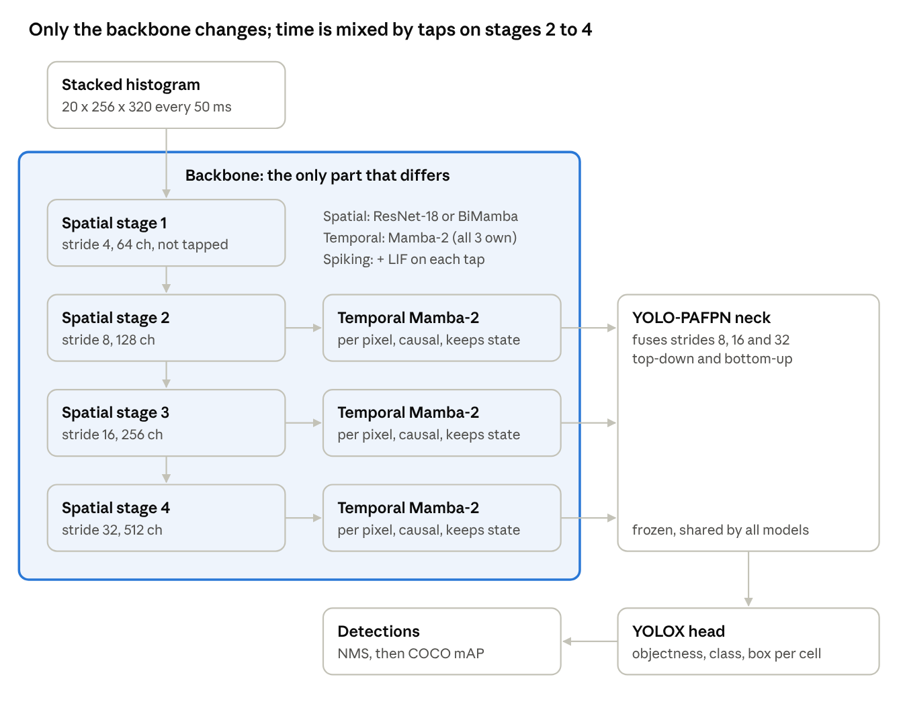

# How the Models Work

2026-10-11 · Benas Vaiciulis · exported from the Claude doc [How the Models Work](https://claude.ai/code/artifact/013ce6d3-ee2e-4845-9bd3-17fa7c076d73)

## The big picture

All four detectors are the same machine with one part swapped: the **backbone**. Everything around it — the input format, the neck, the detection head, the loss, the training recipe and the evaluator — is the verified S5-RVT pipeline, reused unmodified. That is what makes the comparisons fair: a difference between two neighbouring models can only come from the part that differs.

One forward pass, for every model:

1. **Input.** The events from the last 50 ms are binned into a 20-channel image, the *stacked histogram* (section 3), padded to 20 × 256 × 320.
2. **Backbone.** Four stages shrink the image and deepen the features (strides 4/8/16/32, widths 64/128/256/512). Each stage mixes information **in space** (within the frame). Stages 2, 3 and 4 also mix **in time** (across frames, at each pixel), carrying a memory from one frame to the next.
3. **Neck (YOLO-PAFPN).** Combines the three feature scales so that small and large objects are both visible at every scale.
4. **Head (YOLOX).** At every grid cell, predicts: is there an object, which class (car or pedestrian), and its box.
5. **Post-processing.** Drops low-confidence boxes and merges duplicates (non-maximum suppression).
6. **Evaluation.** The Prophesee/COCO evaluator scores the boxes against labels: mAP over IoU 0.50–0.95.

The four models differ only inside step 2:

| Model | Spatial mixer (within a frame) | Temporal mixer (across frames) | What its comparison isolates |
| --- | --- | --- | --- |
| S5-RVT (reproduced baseline) | MaxViT attention | S5 state-space model | the published reference, 47.7 mAP |
| EventSSM | ResNet-18 convolutions, ImageNet-initialised | Mamba-2 | a CNN–SSM hybrid, 46.2 |
| PureSSM | bidirectional Mamba-2 (BiMamba) | Mamba-2, identical | vs EventSSM: the spatial mixer only, 46.4 |
| SpikingSSM | BiMamba, identical | Mamba-2 + leaky integrate-and-fire readout | vs PureSSM: the temporal readout only |

The one idea to hold on to: **space and time are two separate axes inside each backbone stage**, and each model changes exactly one of them relative to its neighbour. The diagram below shows one forward pass.



The spatial stages run on every frame first; each temporal tap feeds the neck only, never the next spatial stage.

## What kind of machine learning this is

These are **supervised, deep, recurrent object detectors**: neural networks trained on labelled examples to find and classify objects, which also remember what they saw in earlier frames.

- **Supervised learning.** Every training recording has hand-drawn boxes (car or pedestrian) at 1–4 Hz. The network predicts boxes, a loss measures how wrong they are, and training adjusts the weights to reduce it.
- **Object detection = classification + localisation.** For every position in a grid the model answers three questions: is something here, what is it, and where exactly is its box. The YOLOX head is *single-stage* (one pass, no separate proposal step) and *anchor-free* (it predicts box size directly rather than adjusting preset template boxes).
- **Deep neural networks (ANNs).** Stacks of layers with millions of learned weights (16–19 M here). Each layer is a simple function — a convolution, a matrix product, a normalisation, a nonlinearity — and depth lets them build features from edges up to whole cars.
- **Three families of layer appear:**
  - **Convolutional networks (CNNs)** slide small learned filters over the image. Good at local patterns; the receptive field grows only slowly with depth. *EventSSM's spatial mixer.*
  - **Attention (Transformers)** lets every position compare itself with every other. Very flexible, but the cost grows with the square of the number of positions. *The baseline's MaxViT limits attention to windows and grids to keep this affordable.*
  - **State-space models (SSMs)** run a linear recurrence: a hidden state is updated step by step and read out. Cost grows linearly with sequence length, and the state is a natural memory. *Mamba in all three of our models; S5 in the baseline.*
- **Recurrent (stateful) models.** Detection here is *streaming*: frames arrive every 50 ms, and the model keeps a memory per pixel so that, for example, a car that stops moving (and so stops producing events) is still remembered. LSTMs/ConvLSTMs do this with a nonlinear recurrence that must run step by step; SSMs use a *linear* recurrence, which can be computed in parallel over a whole sequence during training (a *scan*) and step by step when streaming.
- **Spiking neural networks (SNNs).** Neurons communicate with discrete spikes instead of continuous values, which neuromorphic chips such as Intel's Loihi 2 can process very cheaply. Our spiking model is a **hybrid**: only the temporal readout spikes; the rest is an ordinary ANN.

### How training works

1. **Forward pass:** a batch of 4 samples, each 21 consecutive frames (1.05 s), goes through the network.
2. **Loss:** compares predictions with labels (section 6).
3. **Backward pass:** backpropagation computes the gradient of the loss with respect to every weight. Through time, gradients flow back across the 21 frames only (*truncated backpropagation through time*); the memory carried in from earlier windows is kept but detached.
4. **Update:** the AdamW optimiser (weight decay 0, so effectively Adam) moves the weights. The learning rate follows a **OneCycle** schedule: a short warm-up to 2 × 10⁻⁴, then a linear decay to almost zero by the last step. Gradients are clipped to norm 1.0; arithmetic is bf16 mixed precision.
5. **Repeat** for 400k steps (100k for the spiking ladder). Every 10k steps the full validation split is scored; the best validation checkpoint is evaluated **once** on the test split.

**Mixed batching:** half of each batch *streams* (continues a recording where the last batch stopped, memory carried over) and half starts at random points with an empty memory. The model therefore learns both to use a long memory and to cope without one.

## The input: events and the stacked histogram

An event camera has no frames. Each pixel works on its own and reports an **event** whenever the logarithm of the brightness it sees changes by more than a contrast threshold C:

```latex
\left|\,\log I(x,y,t) - \log I(x,y,t_{\text{last}})\,\right| \;\ge\; C \quad\Longrightarrow\quad e_k = (x_k,\, y_k,\, t_k,\, p_k)
```

where (x, y) is the pixel, t the time in microseconds and p the polarity (brighter = 1, darker = 0). The result is a sparse, asynchronous stream: microsecond timing, very high dynamic range, and nothing at all where the scene is static. Prophesee Gen1 is 304 × 240 pixels, recorded from a car, with labels for cars and pedestrians.

Neural networks on GPUs want dense tensors, so every 50 ms the events are turned into a **stacked histogram** (the RVT preprocessing; every model in the thesis uses it). Each event is first given a time bin b in 0–9 by where it falls inside its 50-ms window:

```latex
b_k = \min\!\left(\left\lfloor B\,\frac{t_k - t_{\min}}{\max(t_{\max}-t_{\min},\,1)}\right\rfloor,\; B-1\right), \qquad B = 10
```

Then events are counted per polarity, bin and pixel, with each count clipped at 10:

```latex
S_{p,b}(x,y) = \min\!\Big(10,\; \sum_k \mathbb{1}[p_k=p]\;\mathbb{1}[b_k=b]\;\mathbb{1}[x_k=x]\;\mathbb{1}[y_k=y]\Big)
```

The 2 polarities × 10 bins are stacked into **20 channels** (channel = 10p + b), giving a 20 × 240 × 304 tensor of small integers, zero-padded to **20 × 256 × 320** so every stage divides cleanly by 32.

What this keeps and loses:

- **Keeps** coarse timing *inside* the 50 ms (10 slices of 5 ms) and the two polarities separately.
- **Loses** exact microsecond timing within a 5-ms bin. The *longer* temporal context (seconds) is the job of the recurrent memory, not of the input.
- **Very sparse:** in a sampled test recording only about 0.1 % of the entries are non-zero. A GPU still processes every zero, which is why sparsity brings no GPU speed-up, and why neuromorphic hardware is interesting.

No normalisation is applied: the network sees raw counts as floats. (The Thesis A plan proposed a voxel grid instead; it was never used.)

## State-space models, from first principles

An SSM is a **learned linear memory**: a hidden state that is updated a little at every step and read out. Everything below builds up from that one idea to the Mamba-2 layer in our models.

### 1. Continuous time

The classic linear state-space system, from control theory:

```latex
h'(t) = A\,h(t) + B\,u(t), \qquad y(t) = C\,h(t) + D\,u(t)
```

u is the input signal, h ∈ ℝᴺ the hidden state (N numbers of memory), y the output. A says how the memory evolves on its own (with negative eigenvalues it decays), B how the input writes into it, C how it is read out, D a direct skip from input to output. Training learns A, B, C, D.

### 2. Discretisation: from a differential equation to a recurrence

Computers work in steps of size Δ. Holding the input constant over each step (zero-order hold) gives an exact discrete system:

```latex
\bar{A} = \exp(\Delta A), \qquad \bar{B} = (\Delta A)^{-1}\big(\exp(\Delta A) - I\big)\,\Delta B
```

```latex
h_k = \bar{A}\,h_{k-1} + \bar{B}\,u_k, \qquad y_k = C\,h_k + D\,u_k
```

The step size is a **memory knob**: with decay rate a < 0, the memory shrinks by exp(Δa) per step. Small Δ → factor near 1 → long memory; large Δ → factor near 0 → the state is mostly overwritten by the current input.

### 3. Diagonal state: thousands of tiny memories

Modern SSMs (S4D, S5, Mamba) make A **diagonal**. Then the N state entries do not interact, and each is a scalar recurrence you can read at a glance:

```latex
h_k[i] = e^{\Delta a_i}\, h_{k-1}[i] + \bar{b}_i\, u_k
```

Unrolling the recurrence shows what the model computes — a weighted sum of the past with exponentially fading weights:

```latex
y_k = \sum_{j \le k} C\,\bar{A}^{\,k-j}\,\bar{B}\,u_j \;+\; D\,u_k
```

**S5** (the baseline's temporal mixer) uses such a diagonal, complex-valued A with one learned Δ per state: the dynamics are fixed after training, the same for every input (*linear time-invariant*).

### 4. Why this is fast: the parallel scan

A recurrence looks inherently sequential, but a *linear* one is not. Each step is the pair (āₖ, bₖ = b̄ₖuₖ), and pairs compose associatively:

```latex
(a_1, b_1) \circ (a_2, b_2) = (a_1 a_2,\; a_2 b_1 + b_2)
```

So a GPU can combine the whole sequence in a tree of depth log L (a *parallel scan*). Total work stays **linear in sequence length L**, against L² for attention, while at deployment the same layer runs one step at a time with a fixed-size state: ideal for a 20 Hz stream. A nonlinear LSTM cannot be parallelised this way.

### 5. Mamba: make the memory knob depend on the input

Mamba's change is small to write and large in effect: Δ, B and C become **functions of the current input** (learned linear projections, with Δ = softplus(·) > 0):

```latex
\Delta_k,\; B_k,\; C_k = f_\theta(u_k), \qquad h_k = e^{\Delta_k A} h_{k-1} + \Delta_k B_k\, u_k, \qquad y_k = C_k h_k + D\,u_k
```

The model can now **choose** per step what to keep: a large Δₖ means "this input matters, overwrite the memory"; a small one means "ignore this, keep remembering". This is *selectivity*. The dynamics vary with the input, so the convolution shortcut of S4 is gone, but the parallel scan still works. (This input-dependent Δ is also why mapping Mamba to Loihi 2 is harder than mapping S4D: the chip would have to recompute the decay every step.)

### 6. Mamba-2: the exact layer in our models

Mamba-2 restricts A further, to one scalar decay a per *head*, which lets the scan be computed in chunks as matrix multiplications on the GPU's tensor cores. Per head j, with input slice xₜ ∈ ℝᴾ and state Hₜ ∈ ℝᴾˣᴺ:

```latex
H^{(j)}_t = \exp\!\big(\Delta^{(j)}_t a^{(j)}\big)\, H^{(j)}_{t-1} + \Delta^{(j)}_t\, x^{(j)}_t B_t^{\top}, \qquad y^{(j)}_t = H^{(j)}_t C_t + D^{(j)} x^{(j)}_t
```

The full layer wraps that recurrence:

1. Project the input up by an expansion factor 2, and separately to a gate z.
2. A short causal convolution (width 4) over time, so each step also sees the previous 3 inputs.
3. Compute Δₜ, Bₜ, Cₜ from the input, and run the scan above (all heads in parallel).
4. Gate and normalise: out = Wₒᵤₜ · RMSNorm(yₜ ⊙ SiLU(zₜ)).

| Setting | Temporal blocks (all 3 own models) | Spatial BiMamba blocks (PureSSM) |
| --- | --- | --- |
| State size N | 64 | 16 |
| Expansion | 2 | 2 |
| Head dimension P | 64 | 64 |
| Causal conv width | 4 | 4 |
| Direction | causal (time flows forward) | both directions |

### Why SSMs for event cameras

- **Streaming with a fixed-size memory:** each new 50-ms frame costs the same, however long the recording.
- **Linear-time training** over long sequences.
- **Δ is literally a time step**, which suggested to Zubić et al. that rescaling Δ at inference could adapt a model to a new event rate. Our finding: under their published checkpoint and code that rescaling did not help, but the SSMs were robust to rate changes anyway.

## The backbones and how the stages connect

A backbone stage does two orthogonal jobs. The **spatial mixer** looks within one frame; the **temporal mixer** looks along time at one pixel. They are separated by reshaping the same tensor two ways:

- **Spatial pass:** time is folded into the batch, (L·B, C, H, W). Every frame of every clip is processed independently, all at once, with no memory.
- **Temporal pass:** space is folded into the batch, (B·H·W, L, C). Every pixel becomes its own sequence of L frames, scanned causally with a memory.

### Stage by stage (padded 256 × 320 input)

| Stage | Stride | Feature map | Channels | Temporal block? | Sent to neck? |
| --- | --- | --- | --- | --- | --- |
| 1 | 4 | 64 × 80 | 64 | no | no |
| 2 | 8 | 32 × 40 | 128 | yes (1,280 pixel-sequences per sample) | yes |
| 3 | 16 | 16 × 20 | 256 | yes (320) | yes |
| 4 | 32 | 8 × 10 | 512 | yes (80) | yes |

Stage 1 has no temporal block because the neck never reads it: a block there would only add dead parameters.

### Taps, not a chain (an easy detail to get wrong)

The whole **spatial pyramid runs first**, on every frame. Each temporal block is then a *tap*: it reads its stage's per-frame features, scans them through time, and sends the result **to the neck only**. The next spatial stage continues from the *per-frame* features, not from the temporal output. In RVT the recurrent output of each stage feeds the next stage instead. Our layout keeps the spatial pyramid stateless (fast, fully batched) and is identical in all three own models, so it does not confound their comparison. The temporal output *replaces* the stage features; there is no skip path around it.

### EventSSM: ResNet-18 spatial mixer

A standard ResNet-18: a stem (7×7 stride-2 convolution, batch norm, ReLU, max-pool), then four residual stages. A residual block learns a correction F(x) and adds it back, y = x + F(x), which keeps deep networks trainable. It starts from ImageNet weights, but ImageNet images have 3 colour channels and ours have 20, so the first convolution is adapted by **average projection**:

```latex
W'_{:,c} = \frac{3}{20}\cdot\frac{1}{3}\sum_{k=1}^{3} W_{:,k}, \qquad c = 1,\dots,20
```

Each pretrained filter is averaged over RGB, copied to all 20 channels and scaled by 3/20, so its total response to a uniform input is unchanged. The pretrained edge and blob detectors therefore work on every time bin and polarity from step one. ResNet-18 is 11.23 M of EventSSM's 19.18 M parameters.

### PureSSM: BiMamba spatial mixer

Each ResNet stage is replaced by a stack of bidirectional Mamba-2 blocks (depths 2, 2, 8, 2 = 14 blocks), trained from scratch. Convolution remains only to downsample: a stem of two 3×3 stride-2 convolutions (20 → 32 → 64 channels) and one 3×3 stride-2 convolution between stages. One block:

```latex
X' = X + \mathrm{DWConv}_{3\times3}(X), \qquad X_{\text{out}} = X' + \mathrm{DropPath}\big(\mathrm{BiScan}(\mathrm{LN}(X'))\big)
```

```latex
\mathrm{BiScan}(u) = W_{\text{out}}\,\mathrm{RMSNorm}\Big(\big[\overrightarrow{\mathrm{SSM}}(u) + \mathrm{flip}\big(\overleftarrow{\mathrm{SSM}}(\mathrm{flip}(u))\big)\big]\odot\mathrm{SiLU}(z)\Big)
```

In words:

1. The feature map is flattened into a sequence of h·w tokens: row by row in even blocks, column by column in odd blocks, so information travels along both image axes.
2. One Mamba-2 scan runs forward along the sequence and one runs backward; their outputs are added. Every token can therefore draw on the whole image, in one layer, at linear cost. This is where PureSSM's large receptive field comes from.
3. The 3×3 depthwise convolution starts at zero, so each block begins as a pure global scan and *learns* how much local mixing to add.
4. Stochastic depth (DropPath, up to 0.1) randomly skips blocks during training as regularisation.

Within a frame there is no causality to respect (the frame is complete), so scanning both ways is legitimate. The spatial scan starts from zero for every frame and carries nothing forward, so time is handled only by the causal temporal blocks. Scan lengths are 5,120 / 1,280 / 320 / 80 tokens for the four stages. Spatial state size is 16 (2-D scans need little memory), against 64 in the temporal blocks. The spatial pyramid is 8.38 M parameters; PureSSM is 16.33 M in total, the smallest model.

### The temporal Mamba blocks (identical in all three own models)

One Mamba-2 layer per stage 2/3/4, at that stage's width (128/256/512), state 64, expansion 2, causal conv 4: about 2.20 M parameters in total. Per pixel it keeps two pieces of state across clips: the last three inputs (for the causal convolution) and the head states H. These are stored batch-major so that RVT's existing state container can detach them between training windows and zero them at recording boundaries, unchanged. Training and streaming evaluation run the same chunked scan kernel, which takes an initial state and returns the final one, so there is no separate inference path that could drift from what was trained. The cost: this per-pixel state is large, 144 MB per stream, against 4.7 MB for S5-RVT.

### The baseline, for contrast

S5-RVT's spatial mixer is **MaxViT**: attention inside local windows plus attention over a sparse grid, giving both local and global context. Its temporal mixer is **S5**, a diagonal, input-independent SSM, interleaved stage by stage as in RVT.

## Neck, head and loss (frozen, shared by all models)

### Neck: YOLO-PAFPN

The three temporal outputs (strides 8, 16, 32) carry different information: fine stride-8 maps see small objects and precise edges; coarse stride-32 maps see whole cars and context. The **PAFPN** (path-aggregation feature pyramid) mixes them in both directions:

1. **Top-down:** coarse features are upsampled and merged into finer ones, so fine maps gain context.
2. **Bottom-up:** fine features are downsampled and merged back into coarser ones, so coarse maps gain detail.

The merges use 1×1 convolutions and CSP blocks (stacks of small convolutions with a shortcut). The output is again three maps, one per scale, each now informed by all scales. (These first 1×1 convolutions are the layers that receive the spikes in the spiking model.)

### Head: YOLOX, decoupled and anchor-free

At every cell of every output map the head predicts, from two separate branches (*decoupled*: classification and box regression do not share their last layers, which trains better):

- **objectness:** the probability that an object's centre is at this cell;
- **class:** car or pedestrian;
- **box:** offsets of the centre from the cell and the box's width and height, predicted directly (*anchor-free*, no preset template boxes).

At test time a box's score is objectness × class probability. Boxes below a confidence threshold (0.001 for evaluation, to capture the full precision–recall curve) are dropped and overlapping duplicates are removed by non-maximum suppression.

### Label assignment: SimOTA

The hard question in training a detector is *which* predictions should be responsible for which ground-truth box. **SimOTA** decides this dynamically every iteration:

1. For each ground-truth box, take the candidate cells near its centre.
2. Score each candidate by a cost: how badly it currently classifies the object plus how poorly its box overlaps (IoU-based).
3. Give each ground-truth box its k lowest-cost candidates, where k itself is set from how well the best candidates already overlap (larger, well-covered objects get more positives).
4. Everything not assigned is a negative (background).

Because the assignment follows the model's current predictions, it adapts as training progresses.

### The loss

```latex
\mathcal{L} = \mathcal{L}_{\text{obj}} + \mathcal{L}_{\text{cls}} + 5\,\mathcal{L}_{\text{IoU}}, \qquad \mathcal{L}_{\text{IoU}} = 1 - \mathrm{IoU}^2
```

- **Objectness and class:** binary cross-entropy, BCE(p, y) = −\[y log p + (1 − y) log(1 − p)\]. Objectness is trained on all cells, class only on the positives.
- **Box:** intersection-over-union between predicted and true box, IoU = area of overlap / area of union; the loss 1 − IoU² is zero for a perfect box and weighted ×5.

(The Thesis A document described this as FCOS + focal loss + GIoU. That was wrong and is corrected in the final thesis: it is YOLOX + BCE + IoU² + SimOTA.)

### Evaluation

The Prophesee/COCO evaluator matches predicted boxes to labels at the labelled timestamps, applies the standard Gen1 filters (it ignores the first half-second of each recording and very small boxes), and computes **COCO mAP**: average precision per class, averaged over IoU thresholds 0.50, 0.55, …, 0.95 and over the two classes. AP\_50 (only IoU ≥ 0.5) is the lenient version; AP\_S/M/L split the result by object size.

## The spiking model

SpikingSSM is PureSSM with one addition: a **leaky integrate-and-fire (LIF)** neuron on the output of each temporal Mamba block (stages 2, 3 and 4). The Mamba recurrence itself is untouched and numerically exact; only what leaves the block changes. Everything else, including the BiMamba spatial pyramid, stays an ordinary network: the model is a **hybrid**.

### The LIF neuron

At every pixel, channel and timestep t, with yₜ the Mamba output:

```latex
m_t = \beta\, m_{t-1} + y_t \qquad \text{(integrate, with leak)}
```

```latex
s_t = \Theta(m_t - \vartheta) \qquad \text{(fire if the membrane crosses the threshold)}
```

```latex
m_t \leftarrow m_t - s_t\,\vartheta \qquad \text{(reset by subtraction)}
```

- mₜ is the **membrane potential**: a running, leaky sum of the inputs.
- β ∈ (0, 1) is the **leak**: how much of the membrane survives each step (initialised at 0.9, learned per channel).
- ϑ is the **threshold** (1.0, fixed during training), Θ the step function (1 if positive, else 0).
- **Reset by subtraction** removes only ϑ after a spike, so the excess above threshold is carried forward rather than thrown away.

The membrane is carried across clips with the Mamba state, so the temporal state of a spiking stage is the pair (Mamba state, membrane).

### Training through a step function: surrogate gradients

Θ has zero slope almost everywhere, so backpropagation would get no signal. The fix: in the **forward** pass use the true step (the model really spikes); in the **backward** pass pretend its derivative is a smooth bump around the threshold, the arctan surrogate:

```latex
\frac{\partial s_t}{\partial m_t} \approx \frac{\alpha/2}{1 + \left(\tfrac{\pi}{2}\,\alpha\,(m_t - \vartheta)\right)^2}, \qquad \alpha = 2
```

This is the standard way to train spiking networks directly with gradient descent.

### Three readouts sharing one membrane

What the neuron passes on to the neck is a design choice, and comparing the choices is the experiment:

| Readout | Output | Sparse? | Binary? |
| --- | --- | --- | --- |
| analog | the pre-reset membrane mₜ, every step | no | no |
| graded | sₜ · mₜ: the membrane value, only when the neuron fires | yes | no |
| spike (binary) | sₜ ∈ {0, 1} | yes | yes |

All three run the same leak and reset, so stepping from one to the next adds exactly one restriction. Together with PureSSM this forms the **ladder**:

1. **PureSSM → analog:** the cost of the LIF dynamics (leak + reset) on their own.
2. **analog → graded:** the cost of **sparsity** (most outputs become zero).
3. **graded → binary:** the cost of **binarisation** (the surviving outputs lose their magnitude).

The predicted order, fixed before training: analog ≥ graded > binary. Graded spikes matter because Loihi 2 supports them natively (a spike carrying an integer payload). Results so far (validation AP, 100k steps): binary 41.8; graded ahead of binary at matched steps, 41.6 vs 40.4 at 80k.

### Why spike the temporal path only

- Spikes are events **in time**, and the temporal block already steps through time, so no extra simulation timesteps are needed. Fully spiking detectors usually repeat every input 4–5 times, multiplying the cost.
- The spatial scan is bidirectional and its axis is not time, so spiking it is ill-defined.
- The honest cost: the spikes only feed the first 1×1 convolutions of the neck, about **1 % of the detector's operations**. Energy savings on neuromorphic hardware would need the spatial backbone to spike as well; that is future work.

### Engineering details that matter

- **Learnable leak without collapse.** β is stored as a logit and mapped through an epsilon-squeezed sigmoid, β = ε + (1 − 2ε)·sigmoid(logit) with ε = 10⁻⁴. A plain sigmoid can round to exactly 0 or 1 in float32, silently turning the neuron into a memoryless unit or a pure integrator.
- **fp32 membrane.** Training is bf16, but bf16 rounds β = 0.999 to 1.0 and flips some spikes; the LIF recurrence always runs in fp32.
- **The arm travels with the checkpoint.** Each checkpoint records its readout (analog/graded/spike and the LIF settings), so a checkpoint cannot accidentally be evaluated as a different arm. Changing a fixed threshold at evaluation needs an explicit override flag and is filed as post-hoc.
- **The null test.** With no spiking stages, the model is numerically identical to PureSSM, which is proven by a test, so any gap is the LIF's doing and not a wiring bug.

## From events to boxes: one frame, end to end

The network never sees individual events. The first step turns the asynchronous stream into a regular sequence of tensors, one every 50 ms; everything after that is synchronous, with memory carried from frame to frame. The trace below follows the spiking model.

1. **Sensor → events.** Each pixel fires on its own: (x, y, t in µs, p). Gen1 stores them in `.dat` files, with hand-drawn boxes at 1–4 Hz.
2. **Events → tensor (where the asynchrony ends).** Every 50 ms the events are counted into the stacked histogram, 20 × 240 × 304. In this project that is done once, offline, by RVT's preprocessing (HDF5 files of `uint8` frames plus timestamps; each label linked to its frame); a live system would do the same on a rolling buffer.
3. **Loading.** Float, zero-padded to 20 × 256 × 320. Training: clips of 21 frames × batch 4 → (21, 4, 20, 256, 320). Test evaluation: each recording streamed from its start, memory carried. Deployment: one frame at a time, L = 1.
4. **Spatial pyramid, no memory.** All 84 frames (21 × 4) go through the BiMamba pyramid at once: (84, 64, 64, 80) → (84, 128, 32, 40) → (84, 256, 16, 20) → (84, 512, 8, 10).
5. **Temporal taps, the memory.** Each stage-2/3/4 map is reshaped so every pixel is a sequence through time, e.g. stage 2: (4·32·40 = 5,120 sequences, 21 steps, 128 channels), and scanned by Mamba-2 from the memory left by the previous clip.
6. **The spiking step.** One LIF neuron per pixel and channel: 163,840 + 81,920 + 40,960 = 286,720 neurons per frame. Per step: membrane = β·membrane + y; spike if ≥ 1; subtract 1 after a spike. The binary readout hands the neck three 0/1 feature maps per frame; the graded readout passes the membrane value where it fired.
7. **Neck.** RVT takes the features one frame at a time; the PAFPN's first 1×1 convolutions read the spike maps (the only place spikes are consumed) and mix the three scales.
8. **Head.** A prediction at every cell: 32×40 + 16×20 + 8×10 = 1,680 per frame, each with centre offsets, width and height, objectness and two class scores. Centre = (cell + offset) × stride; size = exp(prediction) × stride; score = objectness × class probability.
9. **Post-processing.** Drop low scores, then non-maximum suppression keeps one box per object: a short list \[x, y, w, h, class, score\] in sensor pixels (padding is only bottom and right).

**Training vs evaluation vs deployment.** Training runs the whole 21-frame clip through the backbone in one call, but the neck, head and loss only on frames that have labels; the loss flows back through the spikes via the surrogate gradient. Evaluation streams each recording and scores predictions at labelled timestamps. Deployment processes one new frame every 50 ms.

### What 50-ms windows mean for latency

Binning gives up most of the sensor's speed. A detection waits for its window to close (about 25 ms on average, up to 50 ms) and then for the network (13–27 ms on the GPU): roughly 40–75 ms in total, no faster than a 30-fps frame camera. What survives the binning: high dynamic range, almost no motion blur (10 slices of 5 ms inside each window), and sparse sensor output.

The 50 ms is a setting, kept for comparability with the baseline. The true-rate study is exactly the test of shortening it: with 5-ms windows at 200 Hz and no retraining, PureSSM keeps 69.7 % of its accuracy, EventSSM 63.0 % and S5-RVT 62.2 %, and EventSSM and PureSSM run at 210 and 181 Hz with CUDA graphs. Every model is still most accurate at its training rate; "most robust" means it loses the least. Shorter windows with retraining are future work (they need re-preprocessed data and ten-times-longer training sequences).

## How it is programmed

The models are written in **PyTorch**. They plug into the vendored RVT/S5-RVT code (in `external/`, never edited) without forking it: our code registers new backbones at start-up and then runs RVT's own training and evaluation scripts.

### Where each part lives (`code/event_ssm/`)

| File | What it is |
| --- | --- |
| `models/eventssm/resnet_spatial.py` | ResNet-18 spatial stages, 20-channel average-projection stem |
| `models/puressm/bimamba_spatial.py`, `bimamba_block.py`, `_scan2d.py` | BiMamba spatial pyramid, one block, the two-direction 2-D scan |
| `temporal/mamba_temporal.py`, `_scan.py` | the temporal Mamba-2 block and the shared chunked scan (training and streaming) |
| `backbone/resnet_mamba.py` | the shared skeleton: runs the spatial stages, folds to pixel-sequences, applies the temporal taps, handles state |
| `models/spikingssm/lif.py`, `surrogate.py` | the LIF neuron and the arctan surrogate gradient (pure PyTorch, CPU-testable) |
| `models/spikingssm/spiking_temporal.py`, `backbone.py` | Mamba block + LIF composed unmodified; the spiking backbone (a subclass of the shared skeleton) |
| `integration/register.py` | plugs our backbones into RVT (see below) |
| `integration/spiking_ckpt.py`, `resume_guard.py`, `monitors.py` | checkpoint-arm contract, resume safety, training health monitors |
| `configs/` | Hydra configs: one per model, recipe blocks identical |
| `benchmark/` | latency, energy, FLOPs and SOP measurement |
| `eval/` | bootstrap confidence intervals, ladder and threshold-sweep figures |
| `scripts/` | one launcher per stage (`stageNN_*.sh` / `.py`) |
| `tests/` | unit, integration and parity tests |

### How a model gets built: Hydra + registration

1. You choose a model on the command line, e.g. `model=rnndet +experiment/gen1=puressm`. **Hydra** composes RVT's configs with ours into one config tree; the backbone section says `name: PureSSM` plus its settings.
2. Before RVT runs, `register.py` **monkeypatches** two RVT functions: the backbone builder (so `PureSSM`, `ResNetMamba` or `SpikingSSM` returns our class) and the config modifier (which sets the padded input size and number of classes; the stock version only knows MaxViT).
3. `stage6_train.py` / `stage7_eval.py` then execute RVT's unmodified `train.py` / `validation.py`. RVT builds its YoloXDetector, which asks the patched builder for a backbone and gets ours. Neck, head, loss, data and evaluator are RVT's own code.

This is how "frozen pipeline" is enforced in practice: there is no copy of the pipeline that could drift.

### How the memory is carried

The backbone's forward takes the clip and the previous state, and returns features plus the new state:

1. The state for each temporal stage is (causal-conv window, Mamba head states), plus the membrane for spiking stages, stored **batch-major** so it matches RVT's LSTM-state container (the `LstmStates` contract).
2. RVT's training loop keeps one state per batch slot. Between 21-frame windows it **detaches** the state (memory kept, gradient cut: truncated BPTT); when a slot starts a new recording it **zeros** it.
3. At evaluation the same loop streams each test recording from its start with the state carried frame to frame; the same scan kernel serves both, so training and inference cannot disagree.

### Training and evaluation infrastructure

- **PyTorch Lightning** runs the loops, checkpointing and validation every 10k steps; runs are logged to Weights & Biases (offline on the workstation).
- **Kernels:** the official `mamba-ssm` 2.3.2 and `causal-conv1d` CUDA kernels, built by hand for the RTX 5070 Ti (Blackwell, sm\_120) on torch 2.11 / CUDA 12.8. They must be installed with `--no-deps`, or pip upgrades torch and breaks the stack.
- **Hardware:** local RTX 5070 Ti (16 GB) for EventSSM and the spiking runs; a rented RTX 5090 (32 GB) for the PureSSM 400k run.
- **Launchers** (`scripts/stageNN_*`) pin the recipe so a run cannot silently differ; a resume guard refuses a checkpoint from a different schedule length.

### Testing

About 400 CPU tests plus \~30 GPU-marked ones, run with `pytest`. The important kinds:

- **Shape and contract tests:** every block's input/output shapes and state layout.
- **Parity tests:** streaming one frame at a time gives the same result as processing the whole sequence; train and eval paths agree.
- **Null and identity tests:** SpikingSSM with no spiking stages equals PureSSM exactly; the spiking block equals the LIF applied to an identical Mamba block.
- **Safety tests:** wrong-arm checkpoints, mismatched resumes and invalid overrides are refused.
- **Analysis tests:** the bootstrap and sweep tools (these run on the Mac too).

## The code, block by block

All the model code together is about 1,100 lines of Python, because the heavy lifting comes from libraries: the official `mamba-ssm` CUDA kernels, torchvision's ResNet-18 and `einops` for reshapes. Every component is a PyTorch `nn.Module`: `__init__` creates the layers (the learnable weights), `forward` describes the computation, and PyTorch derives the gradients automatically.

### The shared skeleton (`backbone/resnet_mamba.py`)

All three own models use this one class. Its `forward` is the "spatial first, then temporal taps" idea:

```python
def forward(self, x, prev_states=None):
    L, B, C, H, W = x.shape                                   # time, batch, 20 channels, 256, 320
    spat = self.spatial(x.reshape(L * B, C, H, W))            # spatial: all frames at once
    for i in range(num_stages):
        seq = spat[stage].reshape(L, B, c, h, w)
        if str(stage) in self.temporal:                       # stages 2, 3, 4
            folded, dims = MambaTemporalBlock.fold(seq)       # (B*h*w, L, c): one sequence per pixel
            folded, st = self.temporal[str(stage)](folded, prev)   # temporal scan, with memory
            feats[stage] = MambaTemporalBlock.unfold(folded, dims)
            new_states.append(st)                             # memory for the next clip
    return feats, new_states
```

`self.spatial` is the only part that differs between EventSSM and PureSSM: any class with the same interface (`stage_dims`, `strides`, a `forward` returning maps for stages 1–4) can be plugged in.

| Model | `self.spatial` | `self.temporal` |
| --- | --- | --- |
| EventSSM | `ResNetSpatialStages` (37 lines) | `MambaTemporalBlock` × 3 |
| PureSSM | `BiMambaSpatialStages` + block + 2-D scan | `MambaTemporalBlock` × 3, identical |
| SpikingSSM | `BiMambaSpatialStages`, identical | `SpikingSSMBlock` × 3 |

### EventSSM's ResNet-18 (`models/eventssm/resnet_spatial.py`)

torchvision's pretrained ResNet-18 with only the first convolution replaced, to take 20 channels:

```python
w = pretrained_conv1.weight.data.mean(dim=1, keepdim=True)     # average the RGB filters
new.weight.copy_(w.repeat(1, in_ch, 1, 1) * (3.0 / in_ch))     # copy to 20 channels, rescale
```

### PureSSM's BiMamba block (`models/puressm/bimamba_block.py`)

```python
def forward(self, x):                                   # (N, C, H, W)
    x = x + self.dwconv(x)                              # local 3x3 mix, starts at zero
    t = self.norm(rearrange(x, "n c h w -> n h w c"))
    y = self.scan(rearrange(t, "n h w c -> n (h w) c")) # image -> token sequence, scanned both ways
    t = rearrange(y, "n (h w) c -> n h w c", h=h, w=w)
    return x + self.drop_path(rearrange(t, "n h w c -> n c h w"))
```

Odd blocks flatten column-first. The two-direction scan (`_scan2d.py`, 157 lines) is the most complex file.

### The temporal block (`temporal/mamba_temporal.py`, `_scan.py`)

A thin wrapper around `Mamba2(d_model, d_state=64, expand=2, headdim=64)`. Its `forward` hands the input and the previous memory to one shared scan function that returns output and new memory; training and streaming use the same function, so they cannot drift apart.

### The spiking parts (`models/spikingssm/`)

The spiking block is two calls:

```python
y, ssm_state = self.ssm(x, ssm_state)     # the unchanged Mamba block
out, mem = self.lif(y, mem)               # then the LIF neuron
```

The LIF neuron is a plain loop over time, the equations line for line:

```python
for t in range(length):
    mem = beta * mem + xf[:, t]                    # integrate with leak
    spk = atan_spike(mem - thr, self.alpha)        # fire: hard step forward, smooth gradient backward
    mem_pre = mem
    mem = mem - spk.detach() * thr                 # reset by subtraction
    outs.append(spk if spike else spk * mem_pre if graded else mem_pre)
```

The spike function is the one place backpropagation is customised: `surrogate.py` defines a `torch.autograd.Function` whose `forward` returns the true 0/1 step and whose `backward` returns the arctan surrogate slope. Because the spiking parts are pure PyTorch, they are tested on a CPU without the GPU-only Mamba kernels.

### Plugging into RVT

A Hydra YAML file per model names the backbone and its settings, and `integration/register.py` replaces RVT's backbone builder at start-up, so RVT's unmodified training and evaluation scripts build our classes.

## Glossary

| Term | Meaning |
| --- | --- |
| AP / mAP | Average precision: area under the precision–recall curve. COCO mAP averages it over IoU thresholds 0.50–0.95 and over classes |
| AP\_50, AP\_S/M/L | AP at IoU ≥ 0.5 only; AP for small / medium / large objects |
| Backbone | The feature extractor; the only part that differs between the models |
| BCE | Binary cross-entropy, the loss for yes/no predictions |
| bf16 | 16-bit floating point with a wide exponent; halves memory and speeds training |
| Causal | Uses only the past, never the future |
| Δ (step size) | The SSM's time step; controls how fast its memory decays |
| Decoupled head | Separate branches for classification and box regression |
| Effective receptive field | The input region that actually influences an output, measured from gradients |
| Graded spike | A spike carrying a value (here the membrane), supported natively by Loihi 2 |
| Hydra | The configuration system that composes model, data and training settings |
| IoU | Intersection over union of two boxes |
| LIF | Leaky integrate-and-fire neuron |
| Mamba / Mamba-2 | Selective SSMs whose Δ, B and C depend on the input; Mamba-2 uses one decay per head for fast chunked scans |
| Membrane potential | The LIF neuron's internal running sum |
| NIR | Neuromorphic Intermediate Representation, a vendor-neutral export format for spiking models |
| OneCycle | Learning-rate schedule: brief warm-up, then a long decay |
| PAFPN | Path-aggregation feature pyramid: mixes feature scales top-down and bottom-up |
| Parallel scan | Computing a linear recurrence over a whole sequence in parallel |
| Post-hoc | Changed after training, at evaluation only |
| SimOTA | Dynamic assignment of predictions to ground-truth boxes during training |
| SNN | Spiking neural network |
| SOP | Synaptic operation: the work triggered by one spike, the energy unit for SNNs |
| SSM | State-space model: a learned linear recurrence with a hidden state |
| Stacked histogram | The 20-channel event image (2 polarities × 10 time bins) every model takes as input |
| Surrogate gradient | A smooth stand-in for the spike's derivative, used only in the backward pass |
| TBPTT | Truncated backpropagation through time: gradients flow back only within each 21-frame window |
| Temporal tap | A temporal block that reads a stage's features and feeds the neck, without feeding the next stage |
